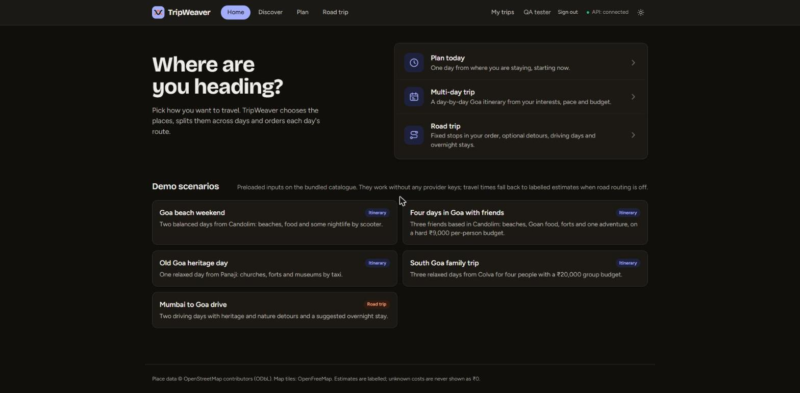
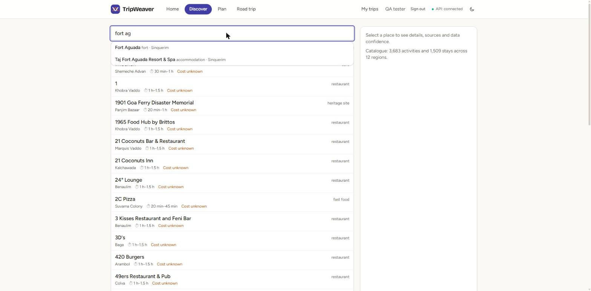
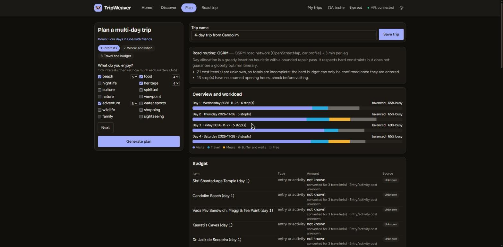
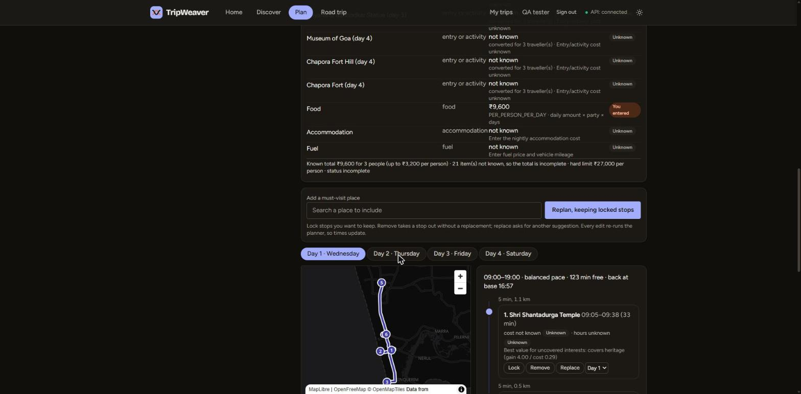
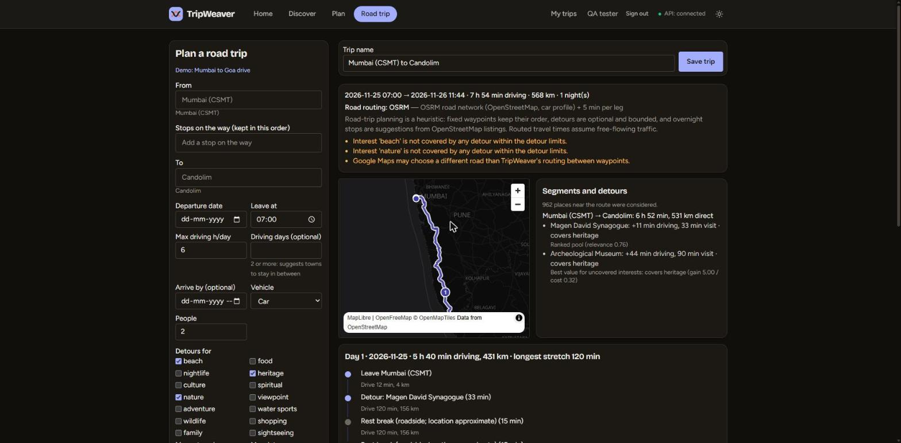

# TripWeaver

Personalised trip planning, itinerary optimisation and collaborative travel. Built for the Advanced Algorithms CIA (Semester V, 2026–27). Destinations: Goa, plus the Mumbai–Goa (Konkan) corridor for road trips.

The full specification is in [`IMPLEMENTATION.md`](IMPLEMENTATION.md). Phase status is in [`docs/PROGRESS.md`](docs/PROGRESS.md).

## What it does

- **Discover:** search about 5,200 real Goa places (OpenStreetMap plus curated official facts) with Trie autocomplete, filters and a map.
- **Plan today / multi-day trip:** a wizard collects interests, base, dates, pace, transport and budget. The planner then:
  1. Ranks places with Randomized Quickselect.
  2. Picks a diverse set with Greedy Weighted Set Cover, driven by an Indexed Max Heap.
  3. Schedules days with opening hours, meals and budget.
  4. Orders each day with Metric TSP Double-Tree.

  You can lock, remove, replace, move or add stops and replan.
- **Road trip:** fixed stops in your order, optional bounded detours, driving-day limits with rests, and suggested overnight stays.
- **Share and collaborate:** save trips, then share with others.
  - Invite companions as editors or viewers.
  - Share a revocable read-only link.
  - Suggest places and vote, split expenses, and see the change history.
  - Edits made at the same time are protected by optimistic locking.
- **Honest labels:** every cost and fact carries its source and confidence. Unknown costs are never shown as ₹0.
- **Light and dark themes:** follows the system setting; the header toggle remembers your choice.

Submission: [`docs/submit/`](docs/submit/) (project proposal and technical report as Word files, plus the showcase and explainer videos). Markdown versions: [`docs/PROPOSAL.md`](docs/PROPOSAL.md), [`docs/REPORT.md`](docs/REPORT.md). Demo script: [`docs/DEMO_SCRIPT.md`](docs/DEMO_SCRIPT.md).

## Screenshots

<p>
  
  
</p>
<p>
  
  
</p>
<p>
  
</p>

Home and modes · Discover with Trie autocomplete · four-day plan overview · day timeline · Mumbai–Goa road trip. All files are in [`docs/screenshots/`](docs/screenshots/).

Algorithm details: [`docs/ALGORITHM_DESIGN.md`](docs/ALGORITHM_DESIGN.md). Tests: [`docs/CORRECTNESS.md`](docs/CORRECTNESS.md). API: [`docs/API_SPEC.md`](docs/API_SPEC.md). Decisions: [`docs/DECISIONS.md`](docs/DECISIONS.md).

## Prerequisites

- JDK 21 or newer (the build targets Java 21). `JAVA_HOME` must point to it, because Maven uses `JAVA_HOME`.
- Node.js 24 and npm
- Docker (for the local PostGIS database, and optionally OSRM). Not needed for the database when you use Supabase.

## Run locally

```bash
# 1. Database: EITHER local PostgreSQL 17 + PostGIS on host port 5433
docker compose up -d db
#    OR hosted Supabase: copy .env.example to .env and set SPRING_DATASOURCE_* (see "Supabase" below)

# 2. Optional road routing (OSRM on host port 5001). One-off preprocessing, about 10 minutes:
#    needs data/raw/western-zone-261122.osm.pbf (see docs/DATA_SOURCES.md)
sh scripts/osrm-prepare.sh
docker compose --profile routing up -d osrm
#    Without OSRM the planner uses labelled straight-line travel estimates.

# 3. Backend API on http://localhost:8088
cd backend
./mvnw spring-boot:run        # Windows: mvnw.cmd spring-boot:run

# 4. Frontend on http://localhost:5173 (proxies /api to :8088)
cd frontend
npm install
npm run dev
```

Open http://localhost:5173.
- **Home page:** three modes (plan today, multi-day trip, road trip) and preloaded demo scenarios. They work without any API keys.
- **Accounts:** use **Sign in** to create an account. You need one to save trips, invite companions and share a read-only link.
- **Demo users:** set `DEMO_PASSWORD` before starting the backend to get asha, ravi and meera.

**First start:** the backend imports the Goa and Konkan catalogues from `data/` on an empty database, which takes a few seconds. Requests made during the import can see an incomplete catalogue, so wait for the `Catalogue import goa` and `Catalogue import konkan` log lines before the first plan.

Configuration comes from environment variables or a `.env` file at the repo root (read by the backend; real environment variables win). See [`.env.example`](.env.example). No API keys are needed for the core workflow.

### Supabase (hosted database)

1. In the Supabase dashboard open **Connect → Session pooler** (IPv4). The direct `db.<ref>.supabase.co` host is IPv6-only on the Free plan.
2. Copy `.env.example` to `.env` and uncomment the three `SPRING_DATASOURCE_*` lines: JDBC URL `jdbc:postgresql://<pooler host>:5432/postgres?sslmode=require`, user `postgres.<project-ref>`, and the database password. Never commit `.env`.
3. Start the backend. Flyway creates the schema (V1–V7: catalogue, PostGIS geography column and GiST index, RLS on every table). The first start imports the Goa and Konkan catalogues (about 11,500 places, about 35 MB).
4. Check: `supabase link --project-ref <ref>`, then `supabase db query --linked -f "$PWD/scripts/verify-db.sql"` (the CLI resolves relative paths against its workdir) (every `ok` must be true) and `supabase db advisors --linked`.

Rebuild or move the catalogue: it is derived entirely from files in Git (`data/sample`, `data/curated`), so an empty database rebuilds it on start. `tripweaver.catalogue.reimport=true` forces a re-import (idempotent upsert by OSM id). User and trip data can be exported with `supabase db dump --linked --data-only`.

### Hosting: Vercel (frontend) + Render (API)

Vercel serves the React app. The Java API runs on Render as a Docker web service, using the same Supabase database. Vercel forwards `/api/*` to Render, so the browser sees one origin and the session cookie works.

- **Vercel:** the project builds `frontend/` from the `dev` branch. `frontend/vercel.json` rewrites `/api/*` to the Render URL and every other path to `index.html`, so deep links such as `/shared/<token>` work.
- **Render:** service `tripweaver-jo2x` (https://tripweaver-jo2x.onrender.com), runtime Docker, Dockerfile path `backend/Dockerfile`, Docker context `.` (repo root), branch `dev`, health check `/api/v1/health`, Singapore, free plan. A build filter (`backend/**`, `data/sample/**`, `data/curated/**`, `.dockerignore`) skips rebuilds for frontend-only or docs-only commits.
  - Environment: `SPRING_DATASOURCE_URL`, `SPRING_DATASOURCE_USERNAME` and `SPRING_DATASOURCE_PASSWORD`, the same values as in `.env`, and `OSRM_BASE_URL=https://router.project-osrm.org` (the public OSRM demo server, set 2026-11-25).
  - The image sets `OSRM_BASE_URL=""` (labelled estimates), `DB_POOL_SIZE=3` and the data directory. The Render variable above overrides the OSRM setting.
  - The free plan sleeps after 15 minutes without traffic, and the first request then takes about a minute. Open the site shortly before a demo.
- **Limits of the hosted version:**
  - Road routing uses the public OSRM demo server, which allows light use only. When it refuses or times out, the plan falls back to labelled straight-line estimates.
  - The sign-in and share-link rate limits count all visitors together, because every request arrives from Vercel's proxy.

### Maps, routing and navigation (no Google API)

- **Map tiles:** MapLibre with OpenFreeMap's OSM-based style by default. Set `VITE_MAP_STYLE_URL` in `frontend/.env.local` to use another provider (see `frontend/.env.example`).
- **Road routing:** self-hosted OSRM. Without it the app says "Road routing unavailable" and labels travel times as straight-line estimates.
- **Navigation:** "Open in Google Maps" links are plain directions URLs built from coordinates. No Google API, key or account is involved, and TripWeaver reads nothing back.
- TripWeaver does not use the Google Places API (decision D39).

## Sample data

The data the app and its tests use is committed, so a fresh clone runs without downloading anything:

| Path | Contents |
|---|---|
| [`data/sample/goa-osm-extract.json`](data/sample/goa-osm-extract.json) | OpenStreetMap places, settlements and the state boundary for Goa (about 5,200 places after import) |
| [`data/sample/konkan-osm-extract.json`](data/sample/konkan-osm-extract.json) | The Mumbai–Goa road-trip corridor (about 6,300 places, including places to stay) |
| [`data/sample/towns-gazetteer.json`](data/sample/towns-gazetteer.json) | Towns used to name road-trip stops |
| [`data/curated/`](data/curated/) | Official entry fees and opening hours, each with a source URL, confidence and verification date; region outlines |

On an empty database the backend imports these files on start. Backend tests use a small in-code catalogue ([`TestCatalogue`](backend/src/test/java/com/tripweaver/support/TestCatalogue.java)) on in-memory H2, and the import tests read the real extracts. Licence and provenance: [`data/sample/README.md`](data/sample/README.md) and [`docs/DATA_SOURCES.md`](docs/DATA_SOURCES.md). The raw `.osm.pbf` is not committed; it is only needed to regenerate the extracts or to build OSRM.

## API examples

Base URL `http://localhost:8088/api/v1` locally (the hosted API is `https://tripweaver-jo2x.onrender.com/api/v1`). Every field and error code is in [`docs/API_SPEC.md`](docs/API_SPEC.md).

```bash
API=http://localhost:8088/api/v1

# Health
curl "$API/health"
# {"time":"…","service":"tripweaver","status":"UP"}

# Trie autocomplete
curl "$API/places/autocomplete?q=agu&limit=3"
# [{"type":"PLACE","label":"Café Aguada",…},{"type":"PLACE","label":"Fort Aguada",…},…]

# Recommendations: Quickselect pruning + lazy-greedy Set Cover
curl -X POST "$API/recommendations/preview" -H 'Content-Type: application/json' \
  -d '{"interests":{"beach":5,"food":4,"heritage":4},"baseLat":15.5202,"baseLon":73.7659,"seed":42}'
# result.coverage.covered = ["beach","food","heritage"], result.coverage.lazyEqualsFull = true

# Two-day itinerary from Candolim, each day ordered by Double-Tree
curl -X POST "$API/itineraries/generate" -H 'Content-Type: application/json' \
  -d '{"baseLat":15.5202,"baseLon":73.7659,"baseName":"Candolim stay","startDate":"2026-12-14","days":2,
       "partySize":2,"interests":{"beach":5,"food":4,"heritage":4},"pace":"BALANCED","seed":42}'
# itinerary.days[].stops[] with times; itinerary.days[].ordering.applied = "DOUBLE_TREE"

# Road trip, Mumbai to Candolim
curl -X POST "$API/road-trips/plan" -H 'Content-Type: application/json' \
  -d '{"origin":{"name":"Mumbai (CSMT)","lat":18.9398,"lon":72.8355},
       "destination":{"name":"Candolim","lat":15.5202,"lon":73.7659},
       "departureDate":"2026-12-14","departureTime":"07:00","interests":{"heritage":5,"beach":4},"seed":42}'
# roadTrip.days[] with DRIVE, REST, MEAL and ARRIVE items; roadTrip.totalKm about 530
```

The same `seed` gives the same plan. Saving and sharing trips needs a signed-in session; see "Trips and collaboration" in the API spec.

## Tests and checks

```bash
cd backend && ./mvnw verify        # tests + Spotless format check (no Docker needed; tests use in-memory H2)
cd backend && ./mvnw spotless:apply # auto-format Java

cd frontend && npm test            # Vitest + React Testing Library
cd frontend && npm run lint        # oxlint
cd frontend && npm run format      # Prettier
cd frontend && npm run build       # type-check + production build
```

Current suite (25 November 2026): 250 backend tests and 65 frontend tests, all passing.

## Project layout

```
backend/src/main/java/com/tripweaver/
  algorithms/      Trie, Randomized Quickselect, Weighted Set Cover, Indexed Max Heap, Double-Tree TSP (own Java code)
  place/, search/  Catalogue import (OSM + curated) and the search index
  recommendation/  Ranking and diverse selection
  planning/        Day scheduling, opening hours, pace, budget
  routing/         OSRM client, estimate fallback, Google Maps links
  roadtrip/        Road-trip planner
  auth/, trip/     Accounts, saved trips, roles, sharing, suggestions, expenses, history
frontend/src/features/  home, discover, plan, roadtrip, trips, auth
data/              Sample OSM extracts (ODbL) and curated files
docs/              Design, decisions, API, data, correctness, benchmarks, progress
```

## Data attribution

Map data © OpenStreetMap contributors, available under the Open Database License (ODbL). Map tiles: OpenFreeMap.
