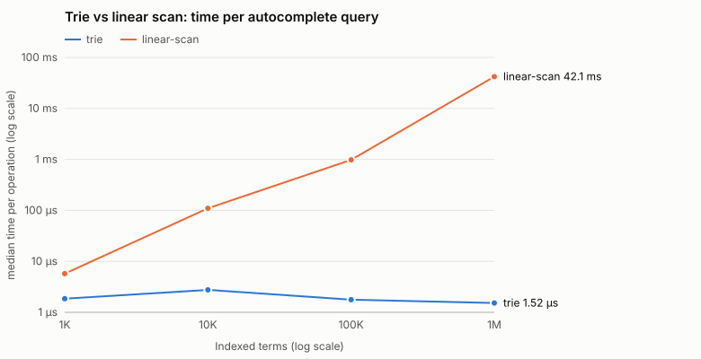
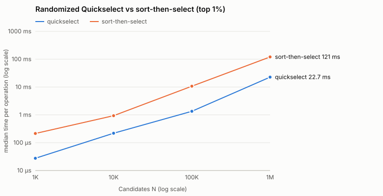
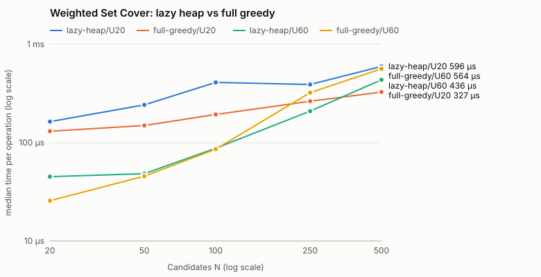
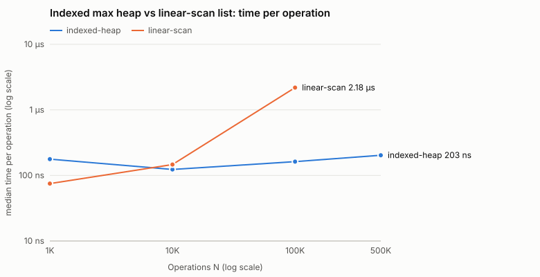
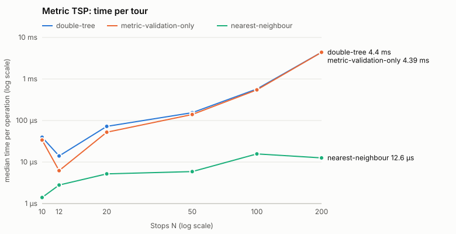

# Benchmarks

All numbers below come from actual runs. Raw per-repetition samples are in `benchmark-results/raw/*.csv`.

Charts: `node scripts/benchmark/plot.mjs` redraws `docs/benchmarks/*.svg` from the newest raw CSV of each algorithm (median per size; the tables also give p25–p75).

## Method

- **Harness:** a custom harness, `backend/src/main/java/com/tripweaver/benchmark/BenchmarkHarness.java`. It runs warm-up executions and discards them, then times each repetition with `System.nanoTime()`. It reports nanoseconds per operation as median, p25, p75 and minimum. A sink value stops the JIT from removing the work being measured.
- **Input generation:** inputs are built outside the timed section, from fixed seeds (`SplittableRandom`).
- **Correctness check:** each implementation's results are compared with its baseline before timing starts. A mismatch aborts the run.
- **Scope:** algorithm time only. No database, network or rendering is included.
- **Command:**
  ```bash
  cd backend
  MAVEN_OPTS=-Xmx4g ./mvnw -q compile exec:java -Dexec.mainClass=com.tripweaver.benchmark.BenchmarkMain -Dexec.args="trie quickselect setcover heap tsp"
  ```

## Environment (run of 2026-11-23)

| Item | Value |
|---|---|
| CPU | AMD Ryzen 7 9800X3D 8-Core Processor (16 logical CPUs) |
| RAM | 31 GB |
| OS | Windows 11 Pro 10.0.26200 |
| JVM | OpenJDK 64-Bit Server VM, Temurin 25.0.1, `-Xmx4g` |
| Build | TripWeaver backend 0.0.1-SNAPSHOT, run through `mvn exec:java` |

Other processes were running on the machine during the run, so treat the numbers as indicative.

## Trie vs linear scan (autocomplete, limit 10)

- **Terms:** synthetic place-like names such as "Canlimgo Beach", including diacritics (é, ã, ç).
- **Queries:** 1,000 random prefixes of 2–5 characters taken from existing terms.
- **Baseline query count:** the linear scan uses 1,000 queries at N ≤ 10K and 50 queries at N ≥ 100K, because each query costs O(N).
- **Runs:** 5 warm-up and 15 measured repetitions per configuration.
- **Raw data:** `benchmark-results/raw/trie-20261123-141011.csv`



| Terms N | Trie median ns/query (p25–p75) | Linear scan median ns/query (p25–p75) | Speed-up |
|---|---|---|---|
| 1,000 | 1,852 (1,719–2,334) | 5,736 (5,216–5,858) | 3.1× |
| 10,000 | 2,752 (2,664–2,893) | 109,562 (107,278–114,272) | 40× |
| 100,000 | 1,770 (1,733–1,821) | 978,298 (946,150–993,185) | 553× |
| 1,000,000 | 1,523 (1,431–1,718) | 42,063,452 (41,943,785–42,389,661) | ~27,600× |

**Interpretation:**
- Trie query time stays roughly flat as N grows. This matches O(m log σ + visited subtree, stopped at 10 results).
- Linear-scan time grows with N, as expected from O(N·m) plus sorting the matches.
- The jump in linear-scan time between 100K and 1M is larger than 10×. Short prefixes match many more entries at 1M, so the baseline also pays to sort a larger hit list.
- Trie time does not rise with N because enumeration stops after 10 accepted results.

## Run of 2026-11-24 (Quickselect, Set Cover, Heap, TSP)

- **Environment:** same machine as above. JVM: Temurin 25.0.1 running bytecode compiled for Java 21, `-Xmx4g`, through `mvn exec:java`. Other processes were running (the backend, the frontend dev server, Docker), so treat the numbers as indicative.
- **Code:** `backend/src/main/java/com/tripweaver/benchmark/AlgorithmBenchmarks.java`. All inputs are synthetic, generated from fixed seeds outside the timed section.
- **Correctness gates before timing:**
  - Quickselect returns the same top-K set as the sort.
  - Lazy greedy picks the same sequence as full greedy.
  - The heap extracts in the same order as the scan.
  - Double-Tree passes the metric check and the bound tour ≤ 2 × MST.
- **Raw data:** `benchmark-results/raw/{quickselect,setcover,heap}-20261124-181429.csv`, `tsp-20261124-181550.csv`. Solution-quality rows are in the matching `*-quality-*.csv` files.

### Randomized Quickselect vs sort-then-select

- **Input:** N candidates with integer scores 0–999, so ties are common. K = max(10, N/100).
- **Ties:** both variants use the planner's tie rule (score descending, then id ascending).
- **Runs:** 5 warm-up and 15 measured repetitions. Each Quickselect repetition uses a new seed, so the time includes the variation between random pivots.



| N | Quickselect median µs (p25–p75) | Sort-then-select median µs (p25–p75) | Speed-up |
|---|---|---|---|
| 1,000 | 27.5 (20.1–51.8) | 213.9 (209.1–238.6) | 7.8× |
| 10,000 | 218.8 (187.0–259.7) | 931.6 (911.7–1,237.5) | 4.3× |
| 100,000 | 1,345.9 (1,151.8–1,620.4) | 10,711.3 (10,636.7–10,804.6) | 8.0× |
| 1,000,000 | 22,716.0 (16,869.7–25,915.1) | 120,725.9 (119,004.6–122,461.5) | 5.3× |

**Partition rounds** (20 seeds per N):

| N | Mean | Min | Max |
|---|---|---|---|
| 1K | 9.3 | 2 | 15 |
| 10K | 11.9 | 3 | 19 |
| 100K | 18.9 | 13 | 30 |
| 1M | 23.4 | 15 | 31 |

**Interpretation:**
- Quickselect time grows about linearly with N, as expected for O(n); the sort grows as n log n.
- The wide p25–p75 range for Quickselect is the CO5 effect: the work depends on the random pivots.

### Greedy Weighted Set Cover: lazy (indexed heap) vs full recomputation

- **Input:** N candidates, each covering 1–5 random tags from a universe of U tags. Tag weights 1–5, costs 30–240.
- **Runs:** 5 warm-up and 15 measured repetitions.
- **Selection:** both variants pick the identical sequence, checked before timing.



| U | N | Lazy median µs | Full median µs | Gain evaluations, lazy / full |
|---|---|---|---|---|
| 20 | 20 | 163.8 | 130.7 | 53 / 155 |
| 20 | 50 | 242.5 | 149.6 | 117 / 372 |
| 20 | 100 | 410.0 | 193.6 | 216 / 679 |
| 20 | 250 | 390.7 | 263.7 | 457 / 1,729 |
| 20 | 500 | 595.9 | 327.3 | 913 / 3,479 |
| 60 | 20 | 45.1 | 25.7 | 50 / 207 |
| 60 | 50 | 48.4 | 45.6 | 137 / 950 |
| 60 | 100 | 87.7 | 85.9 | 246 / 2,124 |
| 60 | 250 | 209.1 | 322.5 | 547 / 5,040 |
| 60 | 500 | 435.8 | 564.3 | 928 / 9,810 |

**Interpretation:**
- **Work:** lazy greedy does 3–11× fewer marginal-gain evaluations. The advantage grows with the number of picks (larger U).
- **Wall-clock time:** lazy greedy is slower at U = 20 and at small N. With only 7–9 picks, the cost of building the heap and creating objects outweighs the evaluations saved. Lazy greedy is faster only at U = 60 with N ≥ 250.
- **The U=20, N=250 lazy figure** is lower than N=100 and has a wide spread; read it as noise.
- **For TripWeaver's real sizes** (tens to a few hundred candidates, about 10 interests), the two take about the same time. The heap's benefit is in the evaluation count, and it pays off as the universe grows.

**Solution quality** (same instances):

| Comparison | Result |
|---|---|
| Greedy vs exact optimum (U = 12, coverable instances; 5 seeds at N = 12, 10 seeds at N = 16 and N = 20) | Mean cost ratio 1.13 (N=12), 1.15 (N=16), 1.09 (N=20). Worst 1.44. The optimum was matched in some seeds at every N |
| Greedy vs cheapest-first (a relevance-only style baseline that ignores coverage, run to the same covered weight) | Greedy is cheaper in all 10 configurations, by 4–38% |

The theoretical bound for greedy weighted set cover is H(max set size) ≤ H(5) ≈ 2.28 here. The observed ratios stay well under it.

### Indexed binary max heap vs linear-scan priority list

- **Workload:** N mixed operations: 50% insert, 25% extractMax, 25% updatePriority on a random id.
- **Baseline:** an unordered array, full scan on every extract (priority recomputation).
- **Correctness:** both produce the same extraction order, checked before timing at every N ≤ 100K.
- **Runs:** 3 warm-up and 10 measured repetitions.



| Operations N | Heap median ns/op (p25–p75) | Scan median ns/op (p25–p75) |
|---|---|---|
| 1,000 | 177.3 (173.6–181.3) | 75.1 (68.3–80.5) |
| 10,000 | 123.3 (109.4–144.0) | 146.7 (128.0–153.0) |
| 100,000 | 162.4 (159.6–170.2) | 2,184.3 (2,160.0–2,204.9) |
| 500,000 | 203.2 (197.5–211.3) | not run (O(N) per extract; about 2.5×10¹⁰ steps) |

**Interpretation:**
- **Heap:** cost per operation stays near 120–200 ns and grows slowly, consistent with O(log n).
- **Scan:** cost grows with the live set. At 1,000 operations the scan wins, because a short array scan is cheaper than heap bookkeeping.
- **Crossover:** around 10K operations. At 100K the heap is 13× faster.

### Metric TSP: Double-Tree vs Nearest-Neighbour vs exact (Held–Karp)

- **Input:** N points uniform in a 30 km square with Euclidean distances, a true metric. The base is node 0.
- **Runs:** 5 warm-up and 15 measured repetitions. Held–Karp: 2 warm-up and 5 measured repetitions, only at N ≤ 12 here (the solver allows up to 16).
- **Metric check:** `DoubleTreeTsp.closedTour` validates the metric (symmetry and the O(n³) triangle check) before building the MST. That check is timed separately.



| N | Double-Tree total median µs | Of which metric check | Nearest-Neighbour median µs | Held–Karp median µs |
|---|---|---|---|---|
| 10 | 39.6 | 33.9 | 1.4 | 107.5 |
| 12 | 14.0 | 6.2 | 2.8 | 589.8 |
| 20 | 72.3 | 52.3 | 5.2 | — |
| 50 | 154.3 | 139.7 | 5.9 | — |
| 100 | 574.4 | 546.5 | 15.7 | — |
| 200 | 4,400.9 | 4,392.6 | 12.6 | — |

At N = 10 the timings are noisy, because JIT compilation of the small case is still settling.

**Tour quality** (10 random instances per N):

| N | Double-Tree / optimum, mean (range) | Nearest-Neighbour / optimum, mean (range) | Double-Tree / MST | Nearest-Neighbour / MST |
|---|---|---|---|---|
| 10 | 1.185 (1.101–1.279) | 1.086 (1.000–1.279) | 1.64 | 1.50 |
| 12 | 1.165 (1.001–1.376) | 1.076 (1.000–1.172) | 1.56 | 1.44 |
| 20 | — | — | 1.52 | 1.45 |
| 50 | — | — | 1.59 | 1.46 |
| 100 | — | — | 1.54 | 1.44 |
| 200 | — | — | 1.55 | 1.41 |

**Interpretation:**
- **Bound:** every Double-Tree tour is within its proven bound (≤ 2 × MST ≤ 2 × optimum); the worst observed was 1.38 × optimum.
- **Quality:** on random uniform points, Nearest-Neighbour gives shorter tours on average. It has no constant-factor guarantee, and its worst case is Θ(log n) × optimum.
- **Product use:** TripWeaver keeps Double-Tree for the guarantee. The planner already compares it with the insertion order and keeps the shorter one (D28), so the product does not lose to Nearest-Neighbour-quality orders in practice.
- **Time:** the O(n³) metric check is 85–99% of Double-Tree's time. MST plus preorder take about 5–30 µs even at N = 200. Daily tours have under 12 stops, so validation costs microseconds there.

