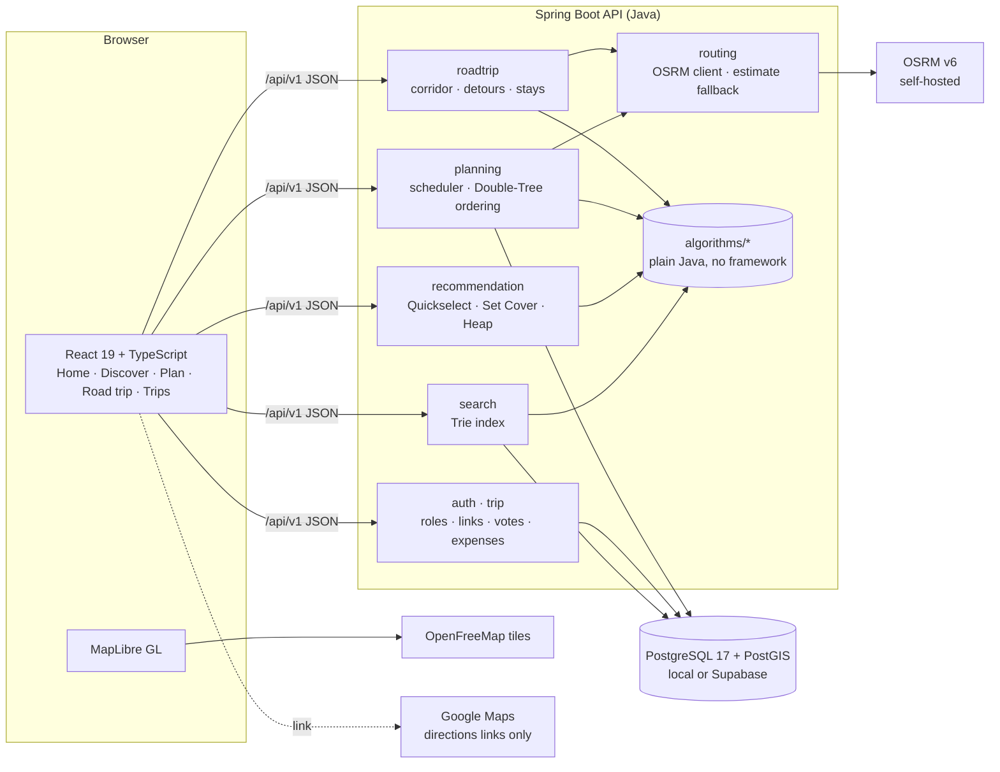

# TripWeaver: technical report

Advanced Algorithms CIA 3, Semester V (2026–27). Solo project (D45). Report date: 24 November 2026.

Related documents: proposal (`PROPOSAL.md`), full algorithm design with pseudocode and proofs (`ALGORITHM_DESIGN.md`), tests (`CORRECTNESS.md`), benchmarks (`BENCHMARKS.md`), data provenance (`DATA_SOURCES.md`), decisions (`DECISIONS.md`), demo script (`DEMO_SCRIPT.md`).

## 1. Problem and goals

TripWeaver plans trips in Goa and on the Mumbai–Goa (Konkan) road. The user gives interests (weighted 1–5), a base, dates, a daily window, a pace, a transport mode, a party size and an optional budget. TripWeaver returns a day-by-day plan that:

1. covers the requested interests with a varied set of places, not only the highest-scoring kind;
2. respects opening hours, meal windows, the day window, the pace and a hard budget;
3. orders each day's stops to keep travel short;
4. labels every cost and fact with its source and confidence, and never shows an unknown cost as ₹0;
5. can be edited (lock, remove, replace, move, add), saved, shared and split among companions.

The planner as a whole is a heuristic. The project claims guarantees only where an algorithm and its preconditions support them.

## 2. Architecture

- **Modular monolith (D8).** One Spring Boot application, organised in feature packages.
- **Algorithms isolated.** The assessed algorithms are in `com.tripweaver.algorithms` and have no Spring, persistence or HTTP dependency. `AlgorithmIsolationTest` enforces this, and no assessed algorithm calls a library implementation.
- **Persistence.** JDBC with Flyway migrations V1–V7.
  - PostGIS adds a generated `geography` column with a GiST index, used by `/places/nearby`.
  - Row-level security denies everything by default (D37), because only the backend connects.
- **Frontend.** React with Tailwind. One colour system ("Indigo & clay", D47), with a light and a dark theme (D48).
  - Maps use MapLibre GL with OpenFreeMap tiles: the `liberty` style in light mode and `dark` in dark mode.
- **External services are optional.**
  - Without OSRM, travel times become labelled straight-line estimates (D40).
  - Without tiles, the map area says so, and the lists and timelines still work.
  - Google appears only as plain directions links, with no API and no key (D39).

**Request flow for a multi-day plan.**
1. The wizard posts an `ItineraryRequest`.
2. The recommendation engine filters and scores the catalogue, prunes it with Quickselect and picks a covering set with lazy greedy Set Cover.
3. The scheduler places the stops into days.
4. Each day is reordered with Double-Tree when that is feasible and shorter.
5. The budget is computed, keeping unknown items unknown.
6. The response carries the timeline, the baselines, the seed and the warnings.

## 3. Data

| Data | Source | Notes |
|---|---|---|
| Places, Goa | OpenStreetMap, Geofabrik western-zone extract (2026-11-22), cropped to the Goa boundary by an own Java extractor | 5,192 places, 12 regions. The derived JSON is committed under ODbL; the raw PBF is not |
| Places, Konkan | Same extract, bounding box minus Goa | 6,283 places, 830 of them places to stay |
| Curated facts | Official sites (Goa government, Goa State Museum, Incredible India) | Each field has a source URL, confidence and `verifiedAt` |
| Road times | Self-hosted OSRM, car profile | Labelled `OSRM`; otherwise `ESTIMATE` (×1.3 straight line, two speeds) |
| Tiles | OpenFreeMap | Free and keyless. Attribution "OpenFreeMap © OpenMapTiles Data from OpenStreetMap" is rendered by MapLibre |

Confidence levels: `VERIFIED`, `OFFICIAL`, `OSM`, `ESTIMATE`, `USER_ENTERED`, `UNKNOWN`. Licences were rechecked on 2026-11-24 (`DATA_SOURCES.md` §9).

## 4. Algorithms

Full pseudocode, proofs and tie rules are in `ALGORITHM_DESIGN.md`. This section summarises each algorithm's job, complexity and the limits of its guarantee.

### 4.1 Trie (Unit 4): autocomplete

- **Structure.** One node per Unicode code point, with children in a `TreeMap` so the order is deterministic.
- **Normalisation.** Keys are normalised (NFKD, accents stripped, case folded, whitespace collapsed), so "Cafe" finds "Café". The display spelling is kept.
- **Query.** `searchPrefix` walks the prefix in O(m log σ), then enumerates in pre-order until L results pass the filter.
- **In the product.** Discover search, the base picker and the must-visit picker all use it.
- **Baseline.** A linear scan: O(N·m) plus a sort of the matches.

### 4.2 Randomized Quickselect (Units 1/6, CO5): candidate pruning

- **Algorithm.** A seeded random pivot with a three-way (Dijkstra) partition, so the many equal scores are handled in one pass. Expected O(n) and worst case O(n²). The output is sorted in O(K log K).
- **Determinism.** The order (score descending, then id) is total, so the selected set does not depend on the seed; only the work does. The seed is returned in every response, which makes runs reproducible.
- **Category quotas.** These reserve slots for each requested interest, so a rare interest is not pruned away by a common one.

### 4.3 Greedy Weighted Set Cover (Unit 5): a varied selection

- **Instance.**
  - Universe: the requested interests with weights 1–5.
  - Sets: the interest tags each candidate place covers.
  - Cost: a positive selection cost that grows with duration, spend and detour, and shrinks with relevance.
- **Rule.** Each step takes argmax(uncovered weight / cost), with ties to the smaller id. Must-visits are preselected.
- **Guarantee boundary.** With equal weights, the cost to cover all coverable tags is ≤ H(d)·OPT. Tests check this against an exhaustive optimum. Neither the weighted variant nor the multi-day itinerary claims a bound.
- **In the product.** Picks the places that anchor coverage. The scheduler then fills the remaining time from the ranked pool.

### 4.4 Indexed Binary Max Heap (Unit 2): lazy greedy

- **Structure.** An array heap plus a hash map from id to position. insert, extractMax and updatePriority cost O(log n); `buildFrom` uses Floyd's heapify in O(n).
- **Lazy greedy.** A stored ratio is an upper bound on the current ratio, because uncovered weight can only fall and costs are fixed. So the algorithm pops a candidate, recomputes its ratio, and accepts it only if it still beats the next stored priority.
- **Equivalence.** Lazy greedy provably picks the same sequence as full recomputation (proof sketch in `ALGORITHM_DESIGN.md` §4). It is checked on 400 random instances and reported live in every response (`lazyEqualsFull`).

### 4.5 Metric TSP Double-Tree (Unit 5): ordering each day

- **Algorithm.** Validate the matrix (square, finite, non-negative, zero diagonal, symmetric, triangle inequality), then build Prim's MST in O(n²), take a pre-order walk from the base and shortcut repeated vertices.
- **Guarantee.** Tour ≤ 2·MST ≤ 2·OPT, claimed only for a validated metric.
- **Road times.** Real road times are directed, so they are symmetrised as (d(i,j)+d(j,i))/2 and validated again. The bound then concerns that symmetric objective, not directed traffic time.
- **Choice of order.** The Double-Tree order is re-simulated with directed legs, opening hours and meals. It replaces the insertion order only if it is feasible and shorter (D28).
- **Road trips.** Detours within a segment are ordered with an open path between fixed ends; no bound is claimed.

### 4.6 Supporting heuristic: the scheduler (not assessed)

The scheduler works in a fixed order:

1. Fixed bookings.
2. Kept stops.
3. Must-visits, with a bounded repair that drops at most 3 stops on one day.
4. A greedy insertion fill. Each round scores every candidate, day and position by coverage value per added burden, under pace caps and a hard budget.

One simulation costs O(n); a greedy round costs O(C·D·n²). The insertion is myopic, so the scheduler is not optimal, and the UI says so on every plan.

## 5. Correctness

| Algorithm | Tests | Examples of edge cases |
|---|---|---|
| Trie | 12 | Empty or blank prefix, accents, Devanagari, delete with pruning, limit 0, filters |
| Randomized Quickselect | 15 | K = 0, K = n, all scores equal, NaN rejected, same set for every seed, input not mutated, quotas and shortfalls |
| Greedy Weighted Set Cover | 15 | Cost ≤ 0 rejected, duplicate ids, uncoverable tags, preselected items, H(d) bound against the exact optimum |
| Indexed Max Heap | 10 | Update up and down, ties by id, build O(n) equals repeated inserts, lazy greedy equals full greedy (400 instances) |
| Metric TSP Double-Tree | 12 | Asymmetric or non-metric input gets no claim, n = 1 and 2, tour ≤ 2·exact (150 instances), open path |

The backend has 250 tests in total (run of 2026-11-25), covering the product-level API, planner, road trips, collaboration, sharing and the absence of any Google dependency. They run on in-memory H2 with no network. The frontend has 65 component tests. A fresh `git clone` passed `./mvnw verify`, `npm ci`, the tests and the production build on 2026-11-24.

## 6. Benchmarks

Method, environment and raw CSVs are in `BENCHMARKS.md`.
- **Inputs:** synthetic, from fixed seeds.
- **Gates:** each pair of variants is checked for identical output before timing.
- **Reported figures:** medians with p25–p75.

| Algorithm vs baseline | Sizes | Result |
|---|---|---|
| Trie vs linear scan | 1K – 1M terms | Trie flat at about 1.5–2.8 µs/query; scan grows with N. 553× faster at 100K |
| Quickselect vs sort | 1K – 1M | 4.3–8.0× faster. Time grows linearly; partition rounds 9 → 23 |
| Lazy vs full greedy Set Cover | 20 – 500 candidates, U = 20 and 60 | 3–11× fewer gain evaluations. Faster in wall time only at U = 60, N ≥ 250 (heap overhead dominates small inputs) |
| Greedy vs exact Set Cover | N = 12 – 20 | Mean cost ratio 1.09–1.15, worst 1.44, far below H(5) ≈ 2.28 |
| Heap vs linear scan | 1K – 500K operations | Scan wins at 1K; break-even near 10K; heap 13× faster at 100K |
| Double-Tree vs NN vs Held–Karp | 10 – 200 stops | All tours within 2×; worst 1.38× optimum. NN is shorter on random points but has no guarantee. The O(n³) metric check is 85–99% of Double-Tree's time |

The results that go against the expected direction (lazy greedy and the heap losing at small sizes, Nearest-Neighbour beating Double-Tree on average) are reported as measured.

## 7. Product verification

- **No-Google check (Phase 11).**
  - Source and dependency tests find no Google API, SDK or key.
  - A database check finds no stored Google content.
  - With routing off, plans come back with labelled estimates.
- **Browser re-test (2026-11-24, Chrome, real backend on Supabase with OSRM).** These flows passed:
  - Home and all demos.
  - Plan today, with the Trie base picker.
  - Multi-day, two and four days.
  - Road trip, Mumbai to Goa.
  - Discover.
  - Sign-up and sign-in.
  - Saving a trip.
  - Adding an expense.
  - Creating a read-only link, opening it in a second tab, and revoking it (the link then fails).
  - The light/dark toggle.
- **Fixes from the re-test:**
  - "Sign in to save" sent the user to another page and lost the plan on screen. Sign-in now happens on the same page.
  - An all-unknown budget showed "Known total ₹0". It now says no costs are known yet.
  - A per-person limit was labelled "₹27,000 per person" although ₹27,000 is the group total. It now reads "₹27,000 for the group (₹9,000 per person)".
  - Weekday names were lower case.

## 8. Assumptions, limitations and failure cases

**Assumptions**
- Travel times are free-flow OSRM car-profile times for car, scooter and taxi, plus a fixed per-leg overhead per mode (for example 3 min for a scooter). Traffic and ferries are not modelled. Walking always uses the estimate.
- Visit durations are category defaults (D14), not measured.
- Only a subset of OSM opening-hours syntax is parsed (D23). Bars and clubs without parseable hours get a labelled 20:00–03:00 estimate (D44). Other places without hours are scheduled freely and flagged "hours unknown".

**Limitations**
- **The planner is heuristic.** The greedy insertion can block a better combination, and repair is bounded. No global optimum is claimed.
- **Data gaps.**
  - Most entry costs are unknown, because OSM rarely tags fees. As a result, a hard budget can often only be confirmed once the user enters costs.
  - Place-to-stay coverage on the NH66 corridor is thin, and no paid hotel source is used.
- **The TSP guarantee is narrow.** It applies to the symmetrised, validated matrix of a closed day. It does not apply to directed traffic time or to road-trip open paths.
- **Scale.** The search index is in memory (D17) and is rebuilt after each catalogue import; nearby search uses PostGIS when it is available.
- **Map theme.** A map picks its style when it mounts, so switching the theme updates maps on the next page load.

**Failure cases and behaviour**

| Situation | Behaviour |
|---|---|
| A must-visit place is closed, avoided or inaccessible | 422 `INFEASIBLE_PLAN` with the conflicts and suggested relaxations |
| Mandatory stops exceed a hard budget | 422 `BUDGET_INFEASIBLE` |
| An interest cannot be covered | The plan is returned with that interest in `uncovered`, with a reason |
| OSRM is down | Labelled straight-line estimates and a "Road routing unavailable" notice |
| Tiles fail | The map area says so; lists and timelines still work |
| Two companions edit the same version | One edit succeeds; the other gets 409 `VERSION_CONFLICT` and nothing is overwritten |
| A revoked or expired share link | "This link is invalid, revoked or expired" |

## 9. Conclusion and future work

TripWeaver uses five own-implemented algorithms where each one fits a real step of trip planning:

- the Trie for search;
- Quickselect for pruning;
- Set Cover with an indexed heap for variety;
- Double-Tree for daily order.

Each claim stays inside its preconditions. The benchmarks report both the gains and the cases where the simpler baseline wins.

Possible next steps:
- traffic-aware time-dependent routing;
- a sourced accommodation and price dataset;
- per-day pace in the wizard;
- re-styling the map in place when the theme changes.
